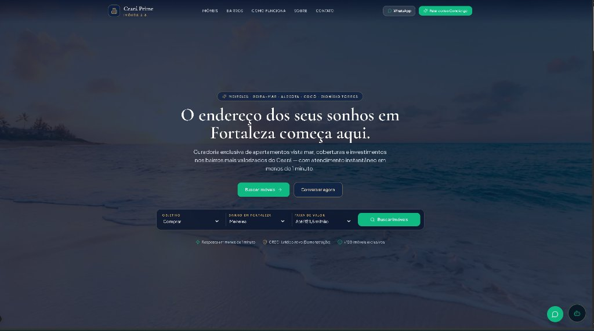
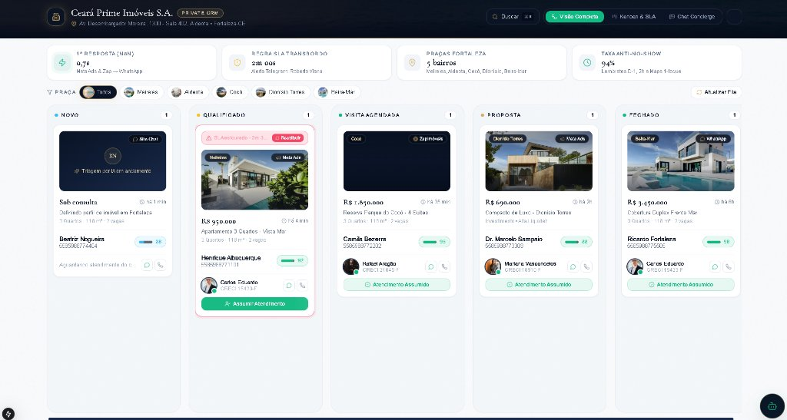
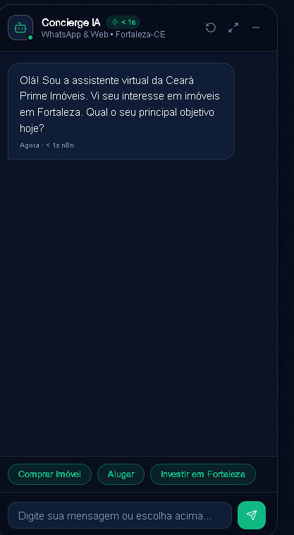
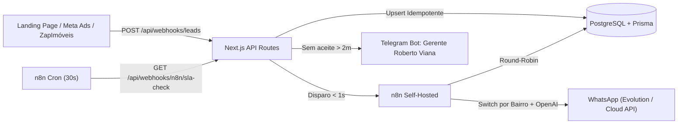

# Ceará Prime Imóveis S.A. — Plataforma Imobiliária, Concierge IA & Private CRM


Plataforma completa de alta conversão para o mercado imobiliário de alto padrão em **Fortaleza-CE** (Meireles, Beira-Mar, Aldeota, Cocó e Dionísio Torres), integrando **Landing Page Pública**, **Catálogo de Imóveis**, **Concierge IA Omnichannel**, **n8n Self-Hosted** e **Private CRM com Kanban e SLA de 2 minutos**.

> **Nota:** Ceará Prime Imóveis S.A., corretores, depoimentos e métricas exibidos são dados fictícios de demonstração.

---

## Prévia Visual

### Landing Page Pública (`/`) — Hero, Busca & Concierge IA


### Private CRM (`/crm`) — Kanban, SLA ao Vivo & Filtros por Bairro


### Concierge IA — Triagem Instantânea & Cards de Imóveis


> **Sobre vídeo de demonstração:** Este repositório não inclui gravação de vídeo `.mp4` embutida; para adicionar um vídeo de tour ao README no GitHub, basta arrastar um arquivo `.mp4` (até 10 MB) diretamente na edição do `README.md` na interface web do GitHub.

---

## Landing Page Pública & Catálogo (`/`, `/imoveis`, `/imoveis/[slug]`)

Projetada com o conceito **"Luxo Litorâneo"** (`navy-950`, `snow-50`, `sand-100`, `gold-400` e `emerald-500` exclusivo para CTAs), alternando seções claras e escuras para máxima conversão:

1. **Header Fixo & Barra de Progresso:** Navegação com glassmorphism que reduz ao rolar, drawer mobile, botão WhatsApp e atalho para o Concierge IA.
2. **Hero `100dvh` com Parallax & Barra de Busca:** Foto da orla de Fortaleza ao entardecer com busca integrada (Objetivo, Bairro e Faixa de Valor) redirecionando para `/imoveis`.
3. **Faixa de Prova Social & Imóveis em Destaque:** Contadores animados no viewport e grid de 6 imóveis com `PropertyCard` (preço, metragem, quartos, vagas e agendamento em 1 clique).
4. **Explore por Bairro:** 5 cards imersivos (**Meireles, Beira-Mar, Aldeota, Cocó e Dionísio Torres**) com faixa de preço média e link direto para o catálogo filtrado.
5. **Como Funciona (3 Passos) & Concierge Showcase:** Linha de progresso SVG animada + mockup em loop do atendimento instantâneo.
6. **Diferenciais, Equipe & Depoimentos (Demonstração):** Corretores especialistas com deep link contextual de WhatsApp.
7. **Formulário de Captação LGPD (`POST /api/webhooks/leads`):** Máscara de telefone BR, captura de UTMs, *honeypot* anti-bot, *rate limiting* por IP e checkbox de consentimento obrigatório (não pré-marcado).
8. **SEO & Acessibilidade:** `sitemap.ts`, `robots.ts`, dados estruturados JSON-LD (`RealEstateAgent` e `Product/Offer`), banner de cookies LGPD e suporte a `prefers-reduced-motion`.

---

## Arquitetura do Sistema



---

## Rotas e Módulos

| Rota | Descrição | Acesso |
|---|---|---|
| `/` | Landing page pública ("Luxo Litorâneo") com busca, bairros de Fortaleza, Concierge IA e formulário LGPD | Público |
| `/imoveis` | Catálogo filtrado por objetivo, bairro e faixa de valor | Público |
| `/imoveis/[slug]` | Página detalhada do imóvel com galeria, JSON-LD e captação direta | Público |
| `/crm` | Private CRM ("Noite em Beira-Mar"): Kanban drag-and-drop, SLA 2m, busca `⌘K` e chat minimizável | Autenticado |
| `/login` | Autenticação da equipe (`MANAGER` e `BROKER`) | Público |

---

## Stack Tecnológica

- **Frontend:** Next.js 15 (App Router), React 18, TypeScript estrito, Tailwind CSS
- **UI & Motion:** Framer Motion (`useReducedMotion`, `layoutId`, drag-and-drop), Lucide React
- **Backend & Dados:** Next.js Route Handlers, Zod, PostgreSQL + Prisma ORM
- **Automação:** n8n Self-Hosted (`n8n/workflows/ceara-prime-omnichannel-flow.json`)
- **Mensageria & IA:** Evolution API / WhatsApp, OpenAI (`gpt-4o-mini`), Telegram Bot API

---

## Como Executar Localmente

1. **Clone e instale as dependências:**
   ```bash
   git clone https://github.com/eltoncelestino/ceara-prime-imobiliaria.git
   cd ceara-prime-imobiliaria
   npm install
   ```

2. **Configure as variáveis de ambiente:**
   ```bash
   cp .env.example .env
   ```
   Preencha `DATABASE_URL` (PostgreSQL), `N8N_WEBHOOK_SECRET`, `EVOLUTION_API_*`, `OPENAI_API_KEY` e `TELEGRAM_*`.

3. **Prepare o banco de dados (opcional para modo demo):**
   ```bash
   npx prisma db push
   npm run db:seed
   ```

4. **Inicie o servidor de desenvolvimento:**
   ```bash
   npm run dev
   ```
   Acesse `http://localhost:3000` para o site público ou `http://localhost:3000/crm` para o Private CRM.

---

## Credenciais de Demonstração (`/login`)

- **Gerente (Roberto Viana):** `roberto.viana@cearaprime.com.br` / `prime2026`
- **Corretor (Carlos Eduardo - CRECI 15423-F):** `carlos.eduardo@cearaprime.com.br` / `prime2026`
