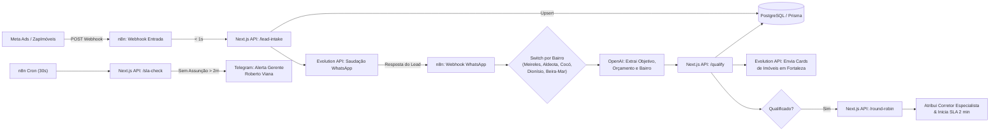

# Arquitetura de Automação n8n — Ceará Prime Imóveis S.A.

## 1. Visão Geral do Fluxo de Dados

## 2. Detalhamento dos Nós do Workflow n8n

O arquivo importável encontra-se em [ceara-prime-omnichannel-flow.json](../n8n/workflows/ceara-prime-omnichannel-flow.json).

### Bloco A — Captação Instantânea (< 1 segundo)
1. **Webhook Entrada (`POST /webhook/ceara-prime/lead-intake`)**: Recebe leads geolocalizados de Fortaleza vindos de Meta Lead Ads ou ZapImóveis. Configurado com `responseMode: onReceived` para liberar o webhook imediatamente.
2. **PostgreSQL Upsert (`POST /api/webhooks/n8n/lead-intake`)**: Autenticado via header `x-n8n-secret`. Cria ou atualiza o lead no PostgreSQL e gera a saudação personalizada.
3. **Evolution API (`sendText`)**: Dispara a mensagem inicial no WhatsApp em menos de 1 segundo.

### Bloco B — Triagem por Bairro e IA
4. **Webhook Resposta WhatsApp**: Escuta mensagens recebidas na instância `ceara-prime-principal` da Evolution API.
5. **Switch por Bairro**: Direciona imediatamente menções a **Meireles**, **Aldeota**, **Cocó**, **Dionísio Torres** e **Beira-Mar** (com fallback para triagem geral).
6. **OpenAI (`gpt-4o-mini`, JSON Mode)**: Extrai estruturadamente `objective` (`COMPRAR | ALUGAR | INVESTIR`), `budgetMax` (em Reais) e `preferredNeighborhood`, além de redigir a resposta humanizada.
7. **PostgreSQL Qualify (`POST /api/webhooks/n8n/qualify`)**: Atualiza o `score` do lead (0–100) e consulta até 3 imóveis compatíveis no banco.

### Bloco C — Round-Robin, Agendamento & Monitoramento de SLA
8. **IF Lead Qualificado**: Quando objetivo, orçamento e bairro estão preenchidos, aciona `/api/webhooks/n8n/round-robin`, priorizando corretores com `specialties` no bairro escolhido e menor `lastAssignedAt`.
9. **Cron SLA Check (a cada 30s)**: Consulta `GET /api/webhooks/n8n/sla-check`. Se algum lead estiver em `HANDOFF_PENDING` há mais de 2 minutos sem `assumedAt`, o nó **Telegram** envia alerta imediato ao gerente **Roberto Viana**.
